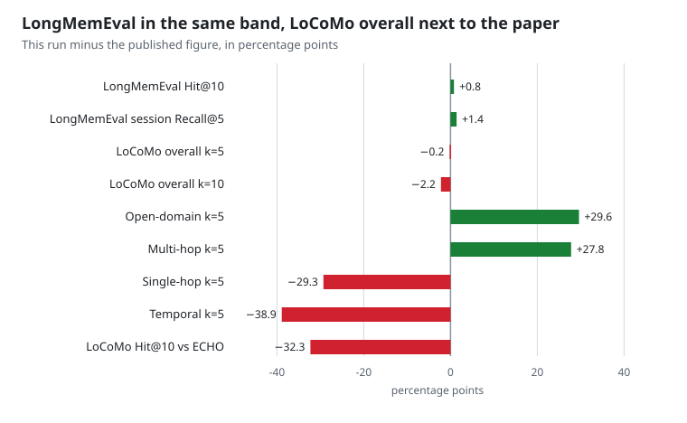

<div align="center">
  

[](https://cursor.com/en/install-mcp?name=rsi-boot&config=eyJjb21tYW5kIjoidXZ4IiwiYXJncyI6WyItLWZyb20iLCJyc2ktYm9vdCIsInJzaSIsInNlcnZlIl19)
[](vscode:mcp/install?%7B%22name%22%3A%22rsi-boot%22%2C%22command%22%3A%22uvx%22%2C%22args%22%3A%5B%22--from%22%2C%22rsi-boot%22%2C%22rsi%22%2C%22serve%22%5D%7D)
[](https://glama.ai/mcp/servers/Apollo-lwx/rsi-boot)
</div>

# RSI Boot

[简体中文](README.md) | English

> **Engineering memory for agents, not chat memory: conventions and prohibitions live in the repo, so another host reads the same copy.**

Cursor removed Memories in 2.1 — new chats know nothing about your project. Claude Code's memory lives on one machine, outside git, so a teammate never sees it. Cloud memory asks for keys and servers, and follows your account. The same gap shows up when one person moves a repo between Cursor, Claude Code, Codex, and DeepSeek Harness, or when a team splits across those tools: conventions, prohibitions, and bug-fix lessons stay behind in whichever tool wrote them down.

RSI Boot keeps conventions, prohibitions, repair lessons, and harness slots in the repo's `.rsi/`. Install once; Cursor, Claude Code, Codex, Qoder, and DeepSeek Harness share that copy. The main path needs no API key and makes no model calls.

The loop is fixed: **recall → do the work → distill a pending note → a person approves it → the next recall reads what was kept.** Negative feedback also lands in failure buckets and may change only writable slots (prompts, skills, recall strategy, intent rules, knowledge). A proposal is promoted only after a static gate and human review, watched for 7 days, and rolled back if adoption drops. That is how the software is built. The published retrieval table is in [benchmark/results/recall-20261028/SUMMARY.md](benchmark/results/recall-20261028/SUMMARY.md). It is not an answer-judge score.

## Not another memory plugin

**rsi-harness (Harness-RSI)**
Negative feedback lands in failure buckets and only writable slots change (prompts / skills / recall strategy / intent rules / knowledge). A proposal must pass the static gate and human review before promotion; it is watched for 7 days and rolled back if adoption drops. What gets kept is a slot version. This loop is in the software. The public benchmark has not yet measured whether the next round is better.

**Follows the project**
Memory is isolated per repo — not per account, not per IDE. Copy the repo, move machines, or rename the directory, and `.rsi/` comes along. Open another repo and you get another copy; nothing leaks across. The harness genome can be exported as a bundle for backup or a slot move.

**One project memory across AI tools and teammates**
One MCP server (`rsi serve`) plugs into Cursor, Qoder, Codex, and DeepSeek Harness; the status line speaks both Claude Code and Cursor CLI. What gets shared is project memory for this repo: how names are written, rules such as "never log card numbers", and how a past null-pointer was fixed. Chat transcripts are not part of it.

Approved conventions are written into the `AGENTS.md` managed block at the repo root, and into `.cursor/rules`. Cursor, Claude Code, Codex, Qoder, and DeepSeek Harness all read that block when they open the repo. With the MCP server connected, recall reads the same `.rsi/`: a prohibition noted in Cursor in the morning is what DeepSeek Harness, or a teammate on Codex, reads from this repo later.

Teammates get the full recall text when the repo contains the same `.rsi/`. Learning adds `.rsi/` to `.gitignore` by default, so logs and cache stay on the machine that created them. To hand the memory over, put the approved files under `.rsi/memory` in version control. Once git ignores the `.rsi/` directory itself, files inside it stay untracked until that ignore rule is narrowed. `AGENTS.md` lives at the repo root and is what everyone already pulls; the managed block comes with it.

| | Host-native memory | Cloud memory (Mem0 and the like) | Generic local memory MCP | RSI Boot |
|---|---|---|---|---|
| Data follows | the account / the host | the cloud user | depends | **the current repo** |
| Switch AI tools or teammates | start over, each copy private | only if that host is wired | usually store-and-recall | **the same `.rsi/` and `AGENTS.md`** |
| Harness self-improvement | no | no | weak or none | **propose → gate → observe → roll back** |
| API key on the main path | bound to the host | required | often | **none** |
| Write gate | the model decides | server-side policy | rare | **review + prohibitions + conflict rulings** |

## Public benchmark

The leaderboard is recall. The cold start returns 5 items. The denominator is questions that have a gold evidence id. MRR is the reciprocal rank of the first hit, from 0 to 1. Tokens are null. Protocol and the per-type breakdown: [benchmark/results/recall-20261028/SUMMARY.md](benchmark/results/recall-20261028/SUMMARY.md).

### This run

| Dataset | Questions with evidence | Hit@5 | Recall@5 | MRR | Hit@10 | Recall@10 | Empty stayed empty |
|---|---:|---:|---:|---:|---:|---:|---:|
| LoCoMo | 1536 | 56.5% | 51.0% | 0.427 | 64.0% | 57.8% | 0/450 |
| LongMemEval-S | 500 | 96.6% | 90.1% | 0.907 | 98.4% | 94.8% | — |

These are retrieval scores, not answer-judge scores.

### Against published retrieval numbers

The published column is a retrieval figure from the papers. This-run column is the table above. Delta is this run minus the published figure, in percentage points. The LoCoMo paper reports dialog recall accuracy; this run uses Hit@5 at k=5 and Hit@10 at k=10. The paper's overall includes adversarial questions. This run's overall is the 1,536 answerable questions. ECHO labels its LoCoMo Hit@10 as a development measurement, and query expansion may have used question-side phrases.

| Source | Slice | Published | This run | Delta |
|---|---|---:|---:|---:|
| LoCoMo paper, dialog k=5 | Single-hop | 68.0 | 38.7 | −29.3 |
| LoCoMo paper, dialog k=5 | Multi-hop | 35.4 | 63.2 | +27.8 |
| LoCoMo paper, dialog k=5 | Temporal | 70.4 | 31.5 | −38.9 |
| LoCoMo paper, dialog k=5 | Open-domain | 33.1 | 62.7 | +29.6 |
| LoCoMo paper, dialog k=5 | Overall, paper includes adversarial | 56.7 | 56.5 | −0.2 |
| LoCoMo paper, dialog k=10 | Overall, paper includes adversarial | 66.2 | 64.0 | −2.2 |
| ECHO, LoCoMo 1,536 questions | Hit@10, development measurement | 96.29 | 64.0 | −32.3 |
| ECHO, LongMemEval-S 500 questions | Hit@10 | 97.60 | 98.4 | +0.8 |
| ECHO, LongMemEval-S | Session Recall@5 | 88.71 | 90.1 | +1.4 |

### Deltas



The four rows within 5 points sit together. The wide gaps are the slices: multi-hop and open-domain are higher; single-hop, temporal, and LoCoMo Hit@10 against ECHO are lower.

| Comparison | This run | Published | Delta |
|---|---:|---:|---:|
| LongMemEval-S Hit@10 | 98.4 | 97.60 | +0.8 |
| LongMemEval-S session Recall@5 | 90.1 | 88.71 | +1.4 |
| LoCoMo overall k=5 | 56.5 | 56.7 | −0.2 |
| LoCoMo overall k=10 | 64.0 | 66.2 | −2.2 |
| LoCoMo open-domain k=5 | 62.7 | 33.1 | +29.6 |
| LoCoMo multi-hop k=5 | 63.2 | 35.4 | +27.8 |
| LoCoMo single-hop k=5 | 38.7 | 68.0 | −29.3 |
| LoCoMo temporal k=5 | 31.5 | 70.4 | −38.9 |
| LoCoMo Hit@10 vs ECHO | 64.0 | 96.29 | −32.3 |

## Installation

Requires Python 3.10+:

```bash
pip install rsi-boot
rsi init
```

To hack on the source instead, clone this repo and use the editable install described in [Development](#development).

`rsi init` only writes the user-level config `~/.rsi/config.yaml`. Project memory lives in each repo's `.rsi/`, created on the first MCP startup or bootstrap run.

## Hooking up Cursor

In the `.cursor/mcp.json` of **the project you want memory for**, add:

```json
{
  "mcpServers": {
    "rsi-boot": {
      "command": "rsi",
      "args": ["serve"],
      "env": {
        "RSI_PROJECT_ROOT": "${workspaceFolder}"
      }
    }
  }
}
```

Then go to Settings → MCP and confirm `rsi-boot` is enabled.

Do not put this in a user-level `mcp.json`. `${workspaceFolder}` often stays unexpanded there, and memory leaks into another repo. Write it in the project you want remembered.

## Other hosts

### Claude Code

Plugin marketplace (recommended — updates with the repo):

```text
/plugin marketplace add Apollo-lwx/rsi-boot
/plugin install rsi-boot@rsi-boot
```

Or add the MCP server directly with one command:

```bash
claude mcp add rsi-boot -- uvx --from rsi-boot rsi serve
```

Open Claude Code from the project you want remembered. The status line is optional and described below.

### Qoder

```bash
qoder mcp add rsi-boot -- rsi serve
```

Or add the same `mcpServers` snippet as Cursor to a project-root `.mcp.json`. Keep it in that project, not in a user-level config.

### Codex

One-command setup (recommended):

```bash
codex mcp add rsi-boot -- uvx --from rsi-boot rsi serve
```

Or write TOML yourself: user-level `~/.codex/config.toml`, or project-level `.codex/config.toml` (loaded only from trusted directories):

```toml
[mcp_servers.rsi-boot]
command = "rsi"
args = ["serve"]
```

Start codex from the project root. To pin the directory, add one line to the table: `env = { RSI_PROJECT_ROOT = "/absolute/path" }`.

### DeepSeek Harness

Open the desktop app from the repository you want remembered. Install `dsh-rsi-boot` on the plugin page, or, if `dsh` is already on your PATH:

```bash
dsh plugin --profile web add dsh-rsi-boot
```

Python 3.10+ is required, and `rsi serve` must run in a terminal. Restart once after installing. Tool names gain an `mcp__rsi-boot__` prefix, for example `mcp__rsi-boot__rsi_recall`. Do not launch from your home directory; `.rsi/` would be written there.

## Status line (optional)

`rsi statusline` renders the host CLI's bottom status line: model, context headroom, token stats (in/out/cache), cost, today's RSI recall/adoption, plus a rotating quip. Works with both Claude Code and Cursor CLI — their `statusLine` hooks pipe a session JSON into stdin, and this command prints a single ANSI-colored line.

Claude Code (`~/.claude/settings.json`):

```json
{
  "statusLine": { "type": "command", "command": "rsi statusline" }
}
```

Cursor CLI (`~/.cursor/cli-config.json`):

```json
{
  "statusLine": { "type": "command", "command": "rsi statusline" }
}
```

Example output:

```
🧠 Kimi K3 │ 📊 ctx left 71% │ ⛽ in 12.3k · out 1.8k · cache 96k │ 💰 $0.42 │ 🐾 RSI recalls 3 · adopted 92% │ sending you a heart ❤
```

### Choosing a quip style

Three equivalent ways — pick per scenario (priority: `--style` > env var > project > user):

```jsonc
// ① Stays with the host: put the flag right in the statusLine command
{ "statusLine": { "type": "command", "command": "rsi statusline --style buddy" } }
```

```yaml
# ② Project level (per-repo style, shared across hosts): <workspace>/.rsi/config.yaml
# ③ User level (global default): ~/.rsi/config.yaml
statusline_style: buddy
```

Six presets: `mixed` (default), `buddy`, `serious`, `healing`, `geek`, `lucky`. The next refresh picks them up.

Put the style on the statusLine command, or set `statusline_style` in config.yaml. Do not put it in `mcp.json`; that file is for the memory server. Language works the same way: `--lang zh` on the command, or `lang: zh` in the project's `.rsi/config.yaml`. To replace the quips, ask the agent to generate status-line copy, then run `rsi statusline --validate-quips`.

## Memory dashboard

No extra `rsi serve` flags. In the project chat, say "open the memory dashboard". Say "close the memory dashboard" and the address below stops responding.

Default route (if the port is taken, use the address the agent returns):

```text
http://127.0.0.1:18765/dashboard
```

The page reads the current repo's `.rsi/` and needs no API key.


## Using it in the chat

After the MCP server is connected, talk to the agent in that project window. You do not start `rsi` in a terminal.

| You say | What happens |
|---------|----------------|
| Learn this project for the first time | It reads the repo and writes pending notes. Recall works after you approve them |
| Re-learn | It clears this repo's memory, then learns again |
| Open the memory dashboard / close the memory dashboard | The local page opens or closes |
| Write down how we just fixed that | The note stays pending until you approve it |
| Do these two contradict | It looks for a conflict and waits for your ruling |

Re-learning deletes memory, logs, and cache under that project's `.rsi`, and keeps `identity.json`. If a file is locked, turn `rsi-boot` off under Settings → MCP first. When `.rsi/bootstrap_report.md` shows no pending items and the run is approved, recall is usable. If the agent says it must pass `--host-judge`, tell it to add that flag and run again.

## Tools

Once connected, the agent in that project gets these tools. On DeepSeek Harness the names gain a prefix, for example `mcp__rsi-boot__rsi_recall`.

| Tool | What it does |
|------|----------------|
| `rsi_recall` | Recall before work. Prohibitions come first, then conventions, docs, and lessons from past fixes |
| `rsi_explore` | Browse the knowledge tree by section. An empty path lists the top sections and their counts; a path lists titles and ids in that branch |
| `rsi_learn` | Learn the repo the first time, write down a lesson from this session, and close the session out |
| `rsi_knowledge_add` | Add a memory. It stays pending until approved, and only then enters recall |
| `rsi_knowledge_search` | Look up an existing memory by question |
| `rsi_knowledge_update` | Edit one entry, or merge near-duplicates into one |
| `rsi_knowledge_delete` | Delete one memory |
| `rsi_knowledge_review` | Approve or reject a pending entry |
| `rsi_conflicts` | Find memories that contradict each other, and wait for your ruling |
| `rsi_memory_health` | Find official memories that are wrong or whose source has gone stale. The scan does not change the store; archiving waits for your confirmation |
| `rsi_memory` | Open the index, open one entry, rebuild the index, or look at how entries relate |
| `rsi_feedback` | Record whether a recall was used. A rejection with a reason can become a prohibition |
| `rsi_review` | Read a harness improvement proposal and its config snapshot, and decide whether to keep it |
| `rsi_stats` | See how often memory is used and how often it is adopted |
| `rsi_impact` | See injection size, how much recall compacts, and adoption and compliance |
| `rsi_web_ui` | Open or close the local memory dashboard. This does not change how `rsi serve` starts |

Fields and call parameters are in [`SKILL.md`](SKILL.md).

## Configuration

Config chain: in-package `default.yaml` → `~/.rsi/config.yaml` → project-root `rsi-boot.yaml` → request parameters.

`RSI_HOME` only overrides the user config directory (default `~/.rsi`). Project memory lives in the working directory's `.rsi/`. Open another repo and you get another copy. The main path needs no setup. Extras such as vector search or model extraction need your own key; the example is in `~/.rsi/config.yaml`.

A project's `rsi-boot.yaml` must not contain a plaintext key. The server refuses to start if it finds one.

## Development

After changing this repository, reload `rsi-boot` under Settings → MCP.

```bash
pip install -e ".[dev]"
python -m pytest
python scripts/export_schemas.py
```

Calling the CLI outside a chat requires `--host-judge` or `--local-judge` on writes (`--dry-run` does not). Migrate an old `.rsi/rsi.db` with `rsi memory migrate`.
