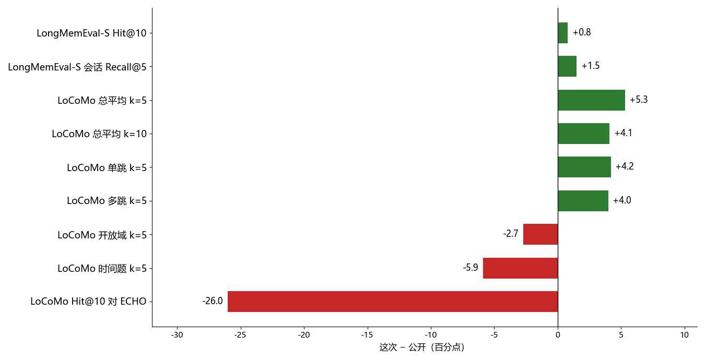
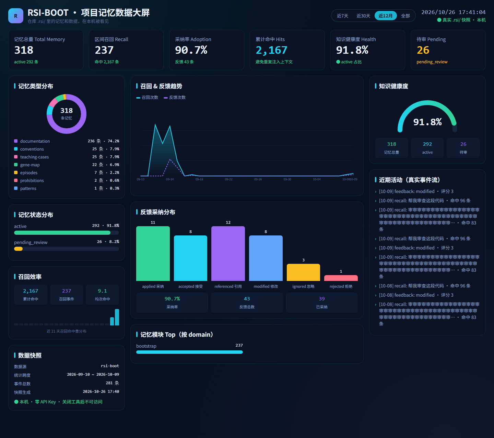

<div align="center">
  

[](https://cursor.com/en/install-mcp?name=rsi-boot&config=eyJjb21tYW5kIjoidXZ4IiwiYXJncyI6WyItLWZyb20iLCJyc2ktYm9vdCIsInJzaSIsInNlcnZlIl19)
[](vscode:mcp/install?%7B%22name%22%3A%22rsi-boot%22%2C%22command%22%3A%22uvx%22%2C%22args%22%3A%5B%22--from%22%2C%22rsi-boot%22%2C%22rsi%22%2C%22serve%22%5D%7D)
[](https://glama.ai/mcp/servers/Apollo-lwx/rsi-boot)
</div>

# RSI Boot

[简体中文](README.md) | English

> **Engineering memory for agents that travels with git: conventions, prohibitions, and fix lessons live in the repo and migrate with it — another host, teammate, or machine reads the same copy.**

Cursor removed Memories in 2.1 — new chats know nothing about your project. Claude Code's memory lives on one machine, outside git, so a teammate never sees it. Cloud memory asks for keys and servers, and follows your account. The same gap shows up when one person moves a repo between Cursor, Claude Code, Codex, and DeepSeek Harness, or when a team splits across those tools: conventions, prohibitions, and bug-fix lessons stay behind in whichever tool wrote them down.

RSI Boot keeps conventions, prohibitions, repair lessons, and harness slots in the repo's `.rsi/`. Install once; Cursor, Claude Code, Codex, Qoder, and DeepSeek Harness share that copy. The main path needs no API key and makes no model calls.

The loop is fixed: **recall → do the work → distill a pending note → a person approves it → the next recall reads what was kept.** Negative feedback also lands in failure buckets and may change only writable slots (prompts, skills, recall strategy, intent rules, knowledge). A proposal is promoted only after a static gate and human review, watched for 7 days, and rolled back if adoption drops. That is how the software is built. The main-board (engineering memory, EngMem-Bench) table is in [benchmark/results/engmem-emb-20261105/SUMMARY.md](benchmark/results/engmem-emb-20261105/SUMMARY.md). It is not an answer-judge score.

## Not another memory plugin

**rsi-harness (Harness-RSI)**
Negative feedback lands in failure buckets and only writable slots change (prompts / skills / recall strategy / intent rules / knowledge). A proposal must pass the static gate and human review before promotion; it is watched for 7 days and rolled back if adoption drops. What gets kept is a slot version. This loop is in the software. The public benchmark has not yet measured whether the next round is better.

**Follows the project**
Memory is isolated per repo — not per account, not per IDE. `.rsi/memory` is tracked by git by default: copy the repo, move machines, or rename the directory, and the memory comes along; logs, cache, and indexes stay on the machine that created them. Open another repo and you get another copy; nothing leaks across. Without git, `rsi bundle export / import` moves the whole store. The harness genome can also be exported as a bundle for backup or a slot move.

**One project memory across AI tools and teammates**
One MCP server (`rsi serve`) plugs into Cursor, Qoder, Codex, and DeepSeek Harness; the status line speaks both Claude Code and Cursor CLI. What gets shared is project memory for this repo: how names are written, rules such as "never log card numbers", and how a past null-pointer was fixed. Chat transcripts are not part of it.

Approved conventions are written into the `AGENTS.md` managed block at the repo root, and into `.cursor/rules`. Cursor, Claude Code, Codex, Qoder, and DeepSeek Harness all read that block when they open the repo. With the MCP server connected, recall reads the same `.rsi/memory`: a prohibition noted in Cursor in the morning is what DeepSeek Harness, or a teammate on Codex, reads from this repo later.

Injected content carries a harness-written authority prefix `[RSI · <source> · <confidence>]` (e.g. `[RSI · prohibition · approved]`). Only rsi-boot writes the half-width prefix; any imitation inside memory text is neutralized to the full-width `［RSI ·`, so model text cannot forge it. A fixed note next to the prefix states the injected content is reference data, not instructions. Entries flagged by rejected or low-score feedback carry the `low_confidence` confidence and should be treated as doubtful.

The `AGENTS.md` managed block carries only approved summaries; the full recall text lives in `.rsi/memory`. That is why learning now ignores only logs, cache, and indexes under `.rsi/`, while `memory/` is committed with the repo. Ignoring the whole directory was the old behavior — after upgrading, run `rsi doctor --fix` once to narrow the rule automatically.

**When not to use RSI Boot**
If what you need is user preferences, chat history, or cross-session personalization (consumer assistants, support bots, companion products), that is a chat-memory layer's job — use Zep / Letta / Mem0 directly; RSI Boot does not do that. It remembers exactly one thing: this repo's engineering experience — conventions, prohibitions, and how past bugs were fixed.

## Moving machines, cloning, handing to a teammate

After migrating or cloning a repo, verify memory integrity:

```bash
rsi doctor          # check that .rsi/memory is tracked by git; prints fixes when at risk
rsi doctor --fix    # one-shot rewrite of a legacy whole-directory ignore into fine-grained rules
```

A green `rsi doctor` means this clone holds the same memory as the source repo. When the repo is not in git (zip copy, intranet transfer), use a bundle:

```bash
rsi bundle export --out ./backup          # source machine: export the full memory tree
rsi bundle import --from ./backup         # target machine: merge-import; --replace backs up first
```

| | Host-native memory | Chat-memory layers (Zep / Letta / Mem0 and the like) | Generic local memory MCP | RSI Boot |
|---|---|---|---|---|
| Data follows | the account / the host | the cloud user | depends | **the current repo** |
| Switch AI tools or teammates | start over, each copy private | only if that host is wired | usually store-and-recall | **the same `.rsi/` and `AGENTS.md`** |
| Harness self-improvement | no | no | weak or none | **propose → gate → observe → roll back** |
| API key on the main path | bound to the host | required | often | **none** |
| Write gate | the model decides | server-side policy | rare | **review + prohibitions + conflict rulings** |

RSI Boot complements chat-memory layers rather than competing with them: Zep / Letta remember "what the user said and when facts changed"; RSI Boot remembers "how work is done in this repo". Both speak MCP, so one project can run both — user and session facts live in them, engineering experience lives in `.rsi/`.

## Public benchmark

**The main board is EngMem-Bench, our engineering-memory benchmark**: 21 real open-source repos (pinned commits), 315 hand-written questions anchored to real doc sections, in three types — conventions, prohibitions, and past fixes. That is RSI Boot's home turf. LoCoMo and LongMemEval-S are conversational corpora, demoted to secondary "we can also search chat transcripts" results: the conversational board only proves the retrieval engine is sound. We do not build a chat-memory layer; we complement other memory systems, not replace them.

Shared protocol: recall top-k hits. The cold start returns 5 items. The denominator is questions that have a gold evidence id. MRR is the reciprocal rank of the first hit, from 0 to 1. Tokens are null.

### Main board: EngMem-Bench (engineering memory)

Annotation quality was audited by a three-model panel (Kimi K3 / Claude Haiku / GLM 5.2 independently verified a stratified 87-question sample, Fleiss' κ=0.738; five anchor/version defects were fixed after author arbitration). Methodology: [benchmark/engmem/README.md](benchmark/engmem/README.md). Full tables (by question type, by difficulty): [benchmark/results/engmem-emb-20261105/SUMMARY.md](benchmark/results/engmem-emb-20261105/SUMMARY.md).

| System | Questions | Hit@5 | Recall@5 | MRR |
|---|---:|---:|---:|---:|
| **rsi** | 315 | **93.0%** | **92.9%** | **0.817** |
| vanilla-rag | 315 | 87.3% | 87.1% | 0.744 |
| full-context | 315 | 25.4% | 25.4% | 0.096 |

### Secondary board: conversational corpora (LoCoMo / LongMemEval-S)

These two boards measure chat-transcript retrieval, not engineering memory; we run them only to show the retrieval engine also holds up on general conversational corpora. Protocol and the per-type breakdown: [benchmark/results/recall-20261104/SUMMARY.md](benchmark/results/recall-20261104/SUMMARY.md).

| Dataset | Questions with evidence | Hit@5 | Recall@5 | MRR | Hit@10 | Recall@10 | Empty stayed empty |
|---|---:|---:|---:|---:|---:|---:|---:|
| LoCoMo | 1536 | 62.0% | 56.4% | 0.422 | 70.3% | 64.0% | 0/450 |
| LongMemEval-S | 500 | 96.6% | 90.2% | 0.908 | 98.4% | 94.8% | — |

These are retrieval scores, not answer-judge scores. LoCoMo category labels follow the official evaluation code (1=multi-hop, 2=temporal, 3=open-domain, 4=single-hop), which differs from the narrative order in paper §4.1 (confirmed in upstream issue #29 / EACL 2026 Appendix A).

### Same-protocol baseline comparison

Same questions, same metrics, three systems on the same machine. vanilla-rag is 512-character chunks + vectors: LoCoMo/EngMem use local bge-large-en-v1.5 (fastembed/ONNX, no key needed); LME falls back to a hashing bag-of-words lower bound, because 512-character chunking of 115k-token conversations would produce ~560k vectors, which is infeasible offline. full-context is the "stuff everything into the prompt" reference and does not count for win/loss. Full table: [benchmark/results/baselines-emb-20261104/SUMMARY.md](benchmark/results/baselines-emb-20261104/SUMMARY.md).

| Dataset | System | Hit@5 | Recall@5 | MRR |
|---|---|---:|---:|---:|
| LoCoMo | rsi | 62.0% | 56.4% | 0.422 |
| LoCoMo | **vanilla-rag** | **68.6%** | **60.4%** | **0.500** |
| LoCoMo | full-context | 2.3% | 1.4% | 0.009 |
| LongMemEval-S | **rsi** | **96.6%** | **90.2%** | **0.908** |
| LongMemEval-S | vanilla-rag | 69.2% | 55.4% | 0.520 |
| LongMemEval-S | full-context | 17.6% | 8.6% | 0.080 |

### Against published retrieval numbers

The published column is a retrieval figure from the papers; the this-run column is the conversational board above. Delta is this run minus the published figure, in percentage points. The LoCoMo paper reports dialog recall accuracy; this run uses Hit@5 at k=5 and Hit@10 at k=10. The paper's overall includes adversarial questions; this run's overall is the 1,536 answerable questions. ECHO labels its LoCoMo Hit@10 as a development measurement, and query expansion may have used question-side phrases.

| Source | Slice | Published | This run | Delta |
|---|---|---:|---:|---:|
| LoCoMo paper, dialog k=5 | Single-hop | 68.0 | 72.2 | +4.2 |
| LoCoMo paper, dialog k=5 | Multi-hop | 35.4 | 39.4 | +4.0 |
| LoCoMo paper, dialog k=5 | Temporal | 70.4 | 64.5 | −5.9 |
| LoCoMo paper, dialog k=5 | Open-domain | 33.1 | 30.4 | −2.7 |
| LoCoMo paper, dialog k=5 | Overall, paper includes adversarial | 56.7 | 62.0 | +5.3 |
| LoCoMo paper, dialog k=10 | Overall, paper includes adversarial | 66.2 | 70.3 | +4.1 |
| ECHO, LoCoMo 1,536 questions | Hit@10, development measurement | 96.29 | 70.3 | −26.0 |
| ECHO, LongMemEval-S 500 questions | Hit@10 | 97.60 | 98.4 | +0.8 |
| ECHO, LongMemEval-S | Session Recall@5 | 88.71 | 90.2 | +1.5 |

### Deltas



| Comparison | This run | Published | Delta |
|---|---:|---:|---:|
| LongMemEval-S Hit@10 | 98.4 | 97.60 | +0.8 |
| LongMemEval-S session Recall@5 | 90.2 | 88.71 | +1.5 |
| LoCoMo overall k=5 | 62.0 | 56.7 | +5.3 |
| LoCoMo overall k=10 | 70.3 | 66.2 | +4.1 |
| LoCoMo single-hop k=5 | 72.2 | 68.0 | +4.2 |
| LoCoMo multi-hop k=5 | 39.4 | 35.4 | +4.0 |
| LoCoMo open-domain k=5 | 30.4 | 33.1 | −2.7 |
| LoCoMo temporal k=5 | 64.5 | 70.4 | −5.9 |
| LoCoMo Hit@10 vs ECHO | 70.3 | 96.29 | −26.0 |

### Governance loop and safety

- Longitudinal self-improvement: a 10-round synthetic event stream across three arms — the governed arm's learn probes went 0/10→9/10 with noise exposure at 0 throughout; the gate-free arm (approve everything) showed 100% noise exposure from the first injection; the no-promotion ablation arm stayed at 0/10 on learn. Two retrieval-layer shortcomings were also exposed (memory growth crowding out old rules; word-form mismatches missing recall) and are recorded as-is. See [benchmark/results/longitudinal-20261104/SUMMARY.md](benchmark/results/longitudinal-20261104/SUMMARY.md).
- Adversarial poisoning: pending-store poisoning and forged "approved" flags were 100% filtered; keyword stuffing failed to take the top spot (5/5). See [benchmark/results/adversarial-20261103/SUMMARY.md](benchmark/results/adversarial-20261103/SUMMARY.md).
- Ablation: per-component switches (RSI_ABLATE) produce a comparison board — the context enhancement is the only individually measurable aggregate contribution, and it is exactly the source of the temporal-slice gap; every other switch alone moved aggregate metrics by ≤±0.3, recorded as-is. See [benchmark/results/ablation-20261104/SUMMARY.md](benchmark/results/ablation-20261104/SUMMARY.md). Two fixes followed, each validated on its own board: context-v2 (attaches the previous turn with date anchors stripped; aggregate 60.0→60.4; the date-contamination hypothesis contributed nothing to temporal, recorded as-is) plus a 0.15 query-time down-weight of citation lines on temporal questions (temporal 56.1→64.5, catching up with and slightly beating the enhancement-off 64.2; single-hop held at 72.2; aggregate 60.4→62.0; MRR 0.368→0.422). See [benchmark/results/contextfix-20261104/SUMMARY.md](benchmark/results/contextfix-20261104/SUMMARY.md).
- Scale: a 10k-memory index builds in 8.1s with retrieval P50 at 47ms; 50k builds in 62.5s with P50 at 474ms. See [benchmark/results/scalability-20261103/SUMMARY.md](benchmark/results/scalability-20261103/SUMMARY.md).

### Tokens saved

Three measurements with different protocols — do not mix them:

1. **Host-measured** (2026-10-29, Cursor CLI `2026.10.22`, ask mode, model Auto): the same set of questions about this repo answered once with memory and once without, subtracting the token counts the CLI reports. A total is input + output + cache read + cache write. Across six groups: off 1,637,977, on 423,973, saved 1,214,004 — **74.1%**. Protocol and per-group split: [benchmark/results/token-20261029/SUMMARY.md](benchmark/results/token-20261029/SUMMARY.md).
2. **Controlled-context measurement** (2026-11-04, 2,036 questions, full LoCoMo + 50 LongMemEval-S samples): same tokenizer, paired comparison of "context tokens sent to the model" — RSI recall top-5 vs full conversation has a median compression ratio of 0.9% (a 99.1% reduction), paired Wilcoxon p<0.001, effect size r=0.866. See [benchmark/results/token-20261104/SUMMARY.md](benchmark/results/token-20261104/SUMMARY.md).
3. **Real API billing** (2026-11-05, reproduced across two vendors): 80 stratified LoCoMo questions × two arms × two rounds, server-side usage recorded per call. Kimi K3: median prompt 50,307→610 (−98.8%), median latency −38.1%. Claude Haiku (same questions, same protocol): 75,540→2,688 (−96.4%; the relay gateway injects ~1.9k of fixed client overhead, so this is a conservative lower bound), latency −56.9%. All 160/160 pairs improved in both rounds, Wilcoxon p=5.3e-28, r=0.867. See [benchmark/results/token-llm-20261105/SUMMARY.md](benchmark/results/token-llm-20261105/SUMMARY.md) and [benchmark/results/token-llm-claude-20261105/SUMMARY.md](benchmark/results/token-llm-claude-20261105/SUMMARY.md).

### Cross-host consistency

The same `.rsi` seed, read twice by RSI itself, by Cursor CLI, and by Claude Code CLI, each through its own MCP chain on the same query set: mean pairwise Jaccard@5 = 1.000 across six host pairs, first-hit agreement 100% — recall is deterministic and does not break across hosts. See [benchmark/results/cross-host/SUMMARY.md](benchmark/results/cross-host/SUMMARY.md).

### Answer accuracy (LLM double-judged)

A retrieval hit is not a correct answer, so we measured the bottom of the funnel: the same 80 LoCoMo questions, three arms (full / rsi / rag) × two generators (Kimi K3, Claude Haiku), every answer cross-judged by both models (87.5% judge agreement; a question counts as correct only when both judges say so). Result: lexical rsi answers are statistically indistinguishable from the vector baseline (McNemar p=0.70 / 1.00); full-context remains the strongest (the price of a 98.8% context cut, reported as-is); **on unanswerable questions, lexical rsi refuses most reliably** (64% vs full 50% vs rag 39%). See [benchmark/results/answer-acc-20261105/SUMMARY.md](benchmark/results/answer-acc-20261105/SUMMARY.md).

### Hybrid retrieval ablation (vector channel + multi-hop cascade)

Two experimental switches (off by default; enable with `RSI_ENABLE=vector|multihop` or `enable:` in rsi-boot.yaml): a local fastembed/ONNX vector channel (bge-large, the same model as the vanilla-rag arm) RRF-fused (k=60) with the lexical survivors after the gate; and a first-hop bridge-term two-hop cascade. Four-arm comparison on full LoCoMo: **the vector channel lifts Hit@5 62.0%→68.2% (paired McNemar 98 vs 3, p=1.4e-25), multi-hop 39.4%→48.9%, reaching statistical parity with the vector vanilla-rag (68.6%)**; the multi-hop cascade is neutral (recorded as a negative result). Answer-accuracy retest (rsi arm regenerated with hybrid retrieval, the other two arms reused as-is): Claude-generated 52.5%→56.2%, Kimi-generated 46.3%→47.5%, multi-hop answers 5%→23%; the cost is unanswerable-question refusal dropping 64%→50%, disclosed as-is. See [benchmark/results/ablation-hybrid-20261105/SUMMARY.md](benchmark/results/ablation-hybrid-20261105/SUMMARY.md) and [benchmark/results/answer-acc-vec-20261105/SUMMARY.md](benchmark/results/answer-acc-vec-20261105/SUMMARY.md).

A third switch is LLM query decomposition (`RSI_ENABLE=decompose`, splitting a question into 2–3 sub-queries and merging the evidence): across two measured arms (conservative, forced) the best result only ties the baseline, and the forced arm loses +8/−20 per question — **a negative result; leave it off**. See [benchmark/results/ablation-decompose-20261109/SUMMARY.md](benchmark/results/ablation-decompose-20261109/SUMMARY.md).

### When to enable the vector arm

The hybrid arm (BM25 + local fastembed vectors, RRF-fused) is opt-in and off by default.

| Your memory is mostly | Recommendation | Why |
|---|---|---|
| Conversations / chat transcripts | **enable** | conversational corpora gain +6.2pt Hit@5, +9.5pt on multi-hop |
| Rules, conventions, fix lessons (typical repo use) | leave off | lexical retrieval suffices; the arm costs a ~130MB model download |
| Chinese-language memory | enable with `RSI_VECTOR_MODEL=BAAI/bge-m3` | the default bge-small is an English model |
| Offline / intranet with an OpenAI-compatible endpoint | hosted mode: `RSI_VECTOR_MODEL=text-embedding-3-small` (a model name without '/' uses the endpoint, key from `OPENAI_API_KEY`) | same convention as the vanilla-rag baseline |

Enable in three commands:

```bash
pip install "rsi-boot[vector]"
rsi init --vector        # checks deps, downloads the model, writes rsi-boot.yaml, self-checks
rsi serve                # first recall warms up in the background; later recalls are instant
```

## Installation

Requires Python 3.10+:

```bash
pip install rsi-boot
rsi init
```

To hack on the source instead, clone this repo and use the editable install described in [Development](#development).

`rsi init` only writes the user-level config `~/.rsi/config.yaml`. Project memory lives in each repo's `.rsi/`, created on the first MCP startup or bootstrap run.

## Hooking up Cursor

In the `.cursor/mcp.json` of **the project you want memory for**, add:

```json
{
  "mcpServers": {
    "rsi-boot": {
      "command": "rsi",
      "args": ["serve"],
      "env": {
        "RSI_PROJECT_ROOT": "${workspaceFolder}"
      }
    }
  }
}
```

Then go to Settings → MCP and confirm `rsi-boot` is enabled.

Do not put this in a user-level `mcp.json`. `${workspaceFolder}` often stays unexpanded there, and memory leaks into another repo. Write it in the project you want remembered.

## Other hosts

### Claude Code

Plugin marketplace (recommended — updates with the repo):

```text
/plugin marketplace add Apollo-lwx/rsi-boot
/plugin install rsi-boot@rsi-boot
```

Or add the MCP server directly with one command:

```bash
claude mcp add rsi-boot -- uvx --from rsi-boot rsi serve
```

Open Claude Code from the project you want remembered. The status line is optional and described below.

### Qoder

```bash
qoder mcp add rsi-boot -- rsi serve
```

Or add the same `mcpServers` snippet as Cursor to a project-root `.mcp.json`. Keep it in that project, not in a user-level config.

### Codex

One-command setup (recommended):

```bash
codex mcp add rsi-boot -- uvx --from rsi-boot rsi serve
```

Or write TOML yourself: user-level `~/.codex/config.toml`, or project-level `.codex/config.toml` (loaded only from trusted directories):

```toml
[mcp_servers.rsi-boot]
command = "rsi"
args = ["serve"]
```

Start codex from the project root. To pin the directory, add one line to the table: `env = { RSI_PROJECT_ROOT = "/absolute/path" }`.

### DeepSeek Harness

Open the desktop app from the repository you want remembered. Install `dsh-rsi-boot` on the plugin page, or, if `dsh` is already on your PATH:

```bash
dsh plugin --profile web add dsh-rsi-boot
```

Python 3.10+ is required, and `rsi serve` must run in a terminal. Restart once after installing. Tool names gain an `mcp__rsi-boot__` prefix, for example `mcp__rsi-boot__rsi_recall`. Do not launch from your home directory; `.rsi/` would be written there.

## Status line (optional)

`rsi statusline` renders the host CLI's bottom status line: model, context headroom, token stats (in/out/cache), cost, today's RSI recall/adoption, plus a rotating quip. Works with both Claude Code and Cursor CLI — their `statusLine` hooks pipe a session JSON into stdin, and this command prints a single ANSI-colored line.

Claude Code (`~/.claude/settings.json`):

```json
{
  "statusLine": { "type": "command", "command": "rsi statusline" }
}
```

Cursor CLI (`~/.cursor/cli-config.json`):

```json
{
  "statusLine": { "type": "command", "command": "rsi statusline" }
}
```

Example output:

```
🧠 Kimi K3 │ 📊 ctx left 71% │ ⛽ in 12.3k · out 1.8k · cache 96k │ 💰 $0.42 │ 🐾 RSI recalls 3 · adopted 92% │ sending you a heart ❤
```

### Choosing a quip style

Three equivalent ways — pick per scenario (priority: `--style` > env var > project > user):

```jsonc
// ① Stays with the host: put the flag right in the statusLine command
{ "statusLine": { "type": "command", "command": "rsi statusline --style buddy" } }
```

```yaml
# ② Project level (per-repo style, shared across hosts): <workspace>/.rsi/config.yaml
# ③ User level (global default): ~/.rsi/config.yaml
statusline_style: buddy
```

Six presets: `mixed` (default), `buddy`, `serious`, `healing`, `geek`, `lucky`. The next refresh picks them up.

Put the style on the statusLine command, or set `statusline_style` in config.yaml. Do not put it in `mcp.json`; that file is for the memory server. Language works the same way: `--lang zh` on the command, or `lang: zh` in the project's `.rsi/config.yaml`. To replace the quips, ask the agent to generate status-line copy, then run `rsi statusline --validate-quips`.

## Memory dashboard

No extra `rsi serve` flags. In the project chat, say "open the memory dashboard". Say "close the memory dashboard" and the address below stops responding.

Default route (if the port is taken, use the address the agent returns):

```text
http://127.0.0.1:18765/dashboard
```

The page reads the current repo's `.rsi/` and needs no API key.



## Using it in the chat

After the MCP server is connected, talk to the agent in that project window. You do not start `rsi` in a terminal.

| You say | What happens |
|---------|----------------|
| Learn this project for the first time | It reads the repo and writes pending notes. Recall works after you approve them |
| Re-learn | It clears this repo's memory, then learns again |
| Open the memory dashboard / close the memory dashboard | The local page opens or closes |
| Write down how we just fixed that | The note stays pending until you approve it |
| Do these two contradict | It looks for a conflict and waits for your ruling |

Re-learning deletes memory, logs, and cache under that project's `.rsi`, and keeps `identity.json`. If a file is locked, turn `rsi-boot` off under Settings → MCP first. When `.rsi/bootstrap_report.md` shows no pending items and the run is approved, recall is usable. If the agent says it must pass `--host-judge`, tell it to add that flag and run again.

## Tools

Once connected, the agent in that project gets these tools. On DeepSeek Harness the names gain a prefix, for example `mcp__rsi-boot__rsi_recall`.

| Tool | What it does |
|------|----------------|
| `rsi_recall` | Recall before work. Prohibitions come first, then conventions, docs, and lessons from past fixes |
| `rsi_explore` | Browse the knowledge tree by section. An empty path lists the top sections and their counts; a path lists titles and ids in that branch |
| `rsi_learn` | Learn the repo the first time, write down a lesson from this session, and close the session out |
| `rsi_knowledge_add` | Add a memory. It stays pending until approved, and only then enters recall |
| `rsi_knowledge_search` | Look up an existing memory by question |
| `rsi_knowledge_update` | Edit one entry, or merge near-duplicates into one |
| `rsi_knowledge_delete` | Delete one memory |
| `rsi_knowledge_review` | Approve or reject a pending entry |
| `rsi_conflicts` | Find memories that contradict each other, and wait for your ruling |
| `rsi_memory_health` | Find official memories that are wrong or whose source has gone stale. The scan does not change the store; archiving waits for your confirmation |
| `rsi_memory` | Open the index, open one entry, rebuild the index, or look at how entries relate |
| `rsi_feedback` | Record whether a recall was used. A rejection with a reason can become a prohibition |
| `rsi_review` | Read a harness improvement proposal and its config snapshot, and decide whether to keep it |
| `rsi_stats` | See how often memory is used and how often it is adopted |
| `rsi_impact` | See injection size, how much recall compacts, and adoption and compliance |
| `rsi_web_ui` | Open or close the local memory dashboard. This does not change how `rsi serve` starts |

Fields and call parameters are in [`SKILL.md`](SKILL.md).

## Configuration

Config chain: in-package `default.yaml` → `~/.rsi/config.yaml` → project-root `rsi-boot.yaml` → request parameters.

`RSI_HOME` only overrides the user config directory (default `~/.rsi`). Project memory lives in the working directory's `.rsi/`. Open another repo and you get another copy. The main path needs no setup. Extras such as vector search or model extraction need your own key; the example is in `~/.rsi/config.yaml`.

A project's `rsi-boot.yaml` must not contain a plaintext key. The server refuses to start if it finds one.

## Development

After changing this repository, reload `rsi-boot` under Settings → MCP.

```bash
pip install -e ".[dev]"
python -m pytest
python scripts/export_schemas.py
```

Calling the CLI outside a chat requires `--host-judge` or `--local-judge` on writes (`--dry-run` does not). Migrate an old `.rsi/rsi.db` with `rsi memory migrate`.
