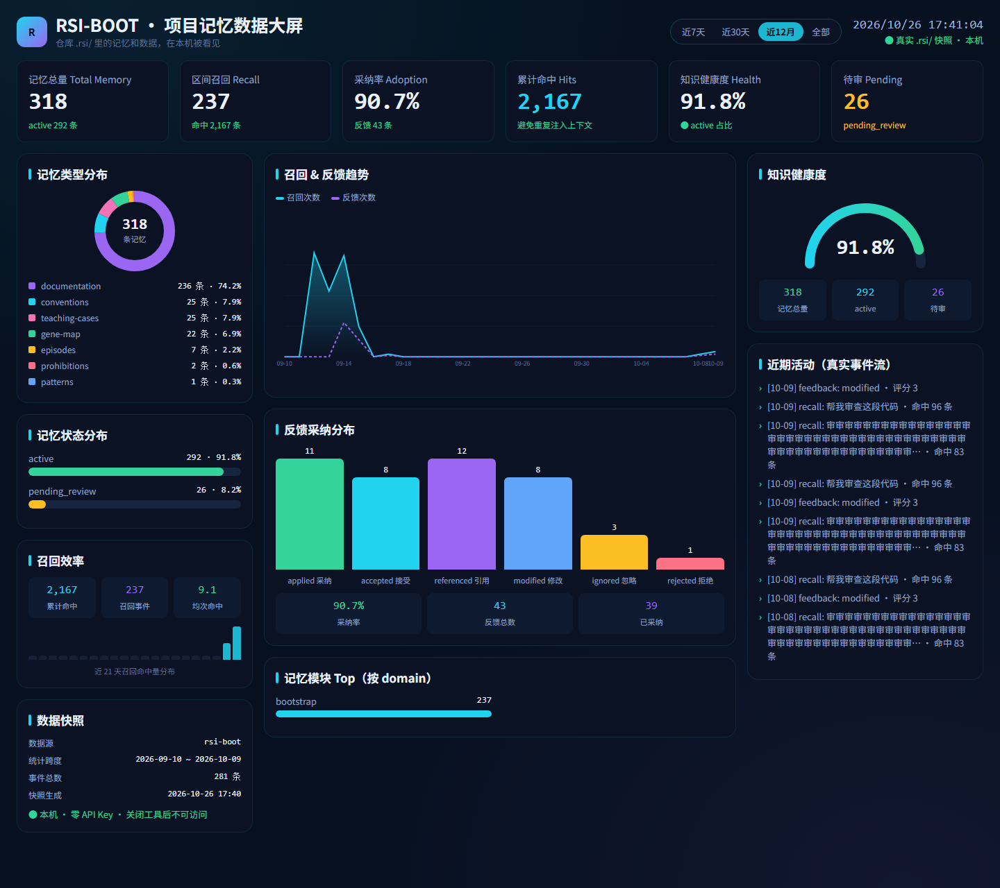

<div align="center">
  

[](https://cursor.com/en/install-mcp?name=rsi-boot&config=eyJjb21tYW5kIjoidXZ4IiwiYXJncyI6WyItLWZyb20iLCJyc2ktYm9vdCIsInJzaSIsInNlcnZlIl19)
[](vscode:mcp/install?%7B%22name%22%3A%22rsi-boot%22%2C%22command%22%3A%22uvx%22%2C%22args%22%3A%5B%22--from%22%2C%22rsi-boot%22%2C%22rsi%22%2C%22serve%22%5D%7D)
[](https://glama.ai/mcp/servers/Apollo-lwx/rsi-boot)
</div>

# RSI Boot

[简体中文](README.md) | English

> **Engineering memory for agents, not chat memory: it travels with the repo, survives host switches, and gets better as you use it.**

Cursor removed Memories in 2.1 — new chats know nothing about your project. Claude Code's memory lives on one machine, outside git, so a teammate never sees it. Cloud memory asks for keys and servers, and follows your account. The same gap shows up when one person moves a repo between Cursor, Claude Code, Codex, and DeepSeek Harness, or when a team splits across those tools: conventions, prohibitions, and bug-fix lessons stay behind in whichever tool wrote them down.

RSI Boot keeps conventions, prohibitions, repair lessons, and harness slots in the repo's `.rsi/`, traveling with the repo: install once, use it from Cursor, Claude Code, Codex, Qoder, and DeepSeek Harness. Negative feedback lands in failure buckets; improvement proposals pass a static gate and human review, are watched for 7 days, and roll back automatically if adoption drops — not more notes, better work. The main path needs no API key and makes no model calls.

## Not another memory plugin

**rsi-harness (Harness-RSI)**
Negative feedback lands in failure buckets and only writable slots change (prompts / skills / recall strategy / intent rules / knowledge). A proposal must pass the static gate and human review before promotion; it is watched for 7 days and rolled back if adoption drops. The point is to get better at the work, not to hoard more notes.

**Follows the project**
Memory is isolated per repo — not per account, not per IDE. Copy the repo, move machines, or rename the directory, and `.rsi/` comes along. Open another repo and you get another copy; nothing leaks across. The harness genome can be exported as a bundle for backup or a slot move.

**One project memory across AI tools and teammates**
One MCP server (`rsi serve`) plugs into Cursor, Qoder, Codex, and DeepSeek Harness; the status line speaks both Claude Code and Cursor CLI. What gets shared is project memory for this repo: how names are written, rules such as "never log card numbers", and how a past null-pointer was fixed. Chat transcripts are not part of it.

Approved conventions are written into the `AGENTS.md` managed block at the repo root, and into `.cursor/rules`. Cursor, Claude Code, Codex, Qoder, and DeepSeek Harness all read that block when they open the repo. With the MCP server connected, recall reads the same `.rsi/`: a prohibition noted in Cursor in the morning is what DeepSeek Harness, or a teammate on Codex, reads from this repo later.

Teammates get the full recall text when the repo contains the same `.rsi/`. Learning adds `.rsi/` to `.gitignore` by default, so logs and cache stay on the machine that created them. To hand the memory over, put the approved files under `.rsi/memory` in version control. Once git ignores the `.rsi/` directory itself, files inside it stay untracked until that ignore rule is narrowed. `AGENTS.md` lives at the repo root and is what everyone already pulls; the managed block comes with it.

| | Host-native memory | Cloud memory (Mem0 and the like) | Generic local memory MCP | RSI Boot |
|---|---|---|---|---|
| Data follows | the account / the host | the cloud user | depends | **the current repo** |
| Switch AI tools or teammates | start over, each copy private | only if that host is wired | usually store-and-recall | **the same `.rsi/` and `AGENTS.md`** |
| Harness self-improvement | no | no | weak or none | **propose → gate → observe → roll back** |
| API key on the main path | bound to the host | required | often | **none** |
| Write gate | the model decides | server-side policy | rare | **review + prohibitions + conflict rulings** |

## Public benchmark

Claims need receipts. RepoMem Bench runs real issues from real repos under three arms: every run is a fresh agent instance, graded by hidden tests, with any `tests/` edit counted as a violation. Tasks, patches, runner, and all 49 raw result files are public — reruns welcome: [benchmark/](benchmark/).

On "temptation tasks" — where a correct fix forces the repo's own stale assertions to fail (4 independent repeats per cell, cross-checked with historical runs; rerun update 2026-10-26):

| Arm | Runs | Edited tests (violations) | Violation rate |
|------|:---:|:---:|:---:|
| A · no context | 12 | 8 | **67%** |
| B · AGENTS.md only | 12 | 0 | **0%** |
| C · RSI Boot memory | 12 | 1 | **8%** |

> On control tasks (no stale assertions) violations are 0 across arms — violations are induced by temptation, not random. C's single violation was an agent that recalled the rule and declared an exception anyway. The 4th-repeat rerun moved the rates from 78% / 0% / 11% to the table above (a same-day 17% figure was withdrawn: one non-independent repeat was excluded). Full report with threats to validity: [48-run report](benchmark/results/SUMMARY-v5-final-36runs.md).

## Installation

Requires Python 3.10+:

```bash
pip install rsi-boot
rsi init
```

To hack on the source instead, clone this repo and use the editable install described in [Development](#development).

`rsi init` only writes the user-level config `~/.rsi/config.yaml`. Project memory lives in each repo's `.rsi/`, created on the first MCP startup or bootstrap run.

## Hooking up Cursor

In the `.cursor/mcp.json` of **the project you want memory for**, add:

```json
{
  "mcpServers": {
    "rsi-boot": {
      "command": "rsi",
      "args": ["serve"],
      "env": {
        "RSI_PROJECT_ROOT": "${workspaceFolder}"
      }
    }
  }
}
```

Then go to Settings → MCP and confirm `rsi-boot` is enabled. Reload the MCP after changing this repository's code.

Do **not** configure a user-level `mcp.json`: `${workspaceFolder}` in `args` often goes unexpanded there, which leaks memory across repos. Workspace binding order: `RSI_PROJECT_ROOT` (project-level mcp.json, recommended — explicit contract) → MCP `roots/list` (answered automatically by Cursor in plugin form) → the `WORKSPACE_FOLDER_PATHS` variable injected by Cursor → process cwd.

## Other hosts

### Claude Code

Plugin marketplace (recommended — updates with the repo):

```text
/plugin marketplace add Apollo-lwx/rsi-boot
/plugin install rsi-boot@rsi-boot
```

Or add the MCP server directly with one command:

```bash
claude mcp add rsi-boot -- uvx --from rsi-boot rsi serve
```

The workspace is claimed automatically via roots/cwd. See the status line section below for the Claude Code statusLine integration.

### Qoder

This repository is also a Qoder plugin: the `.qoder-plugin/plugin.json` manifest plus the root `mcp.json` (the same MCP config shared with the Cursor plugin) — zip it to distribute. To wire it up manually, either:

```bash
qoder mcp add rsi-boot -- rsi serve
```

or add the same `mcpServers` snippet as Cursor to a project-root `.mcp.json`. Workspace binding order is identical (`RSI_PROJECT_ROOT` → roots/list → injected variables → cwd).

### Codex

One-command setup (recommended):

```bash
codex mcp add rsi-boot -- uvx --from rsi-boot rsi serve
```

Or write TOML yourself: user-level `~/.codex/config.toml`, or project-level `.codex/config.toml` (loaded only from trusted directories):

```toml
[mcp_servers.rsi-boot]
command = "rsi"
args = ["serve"]
```

Just start codex from the project root — the MCP child process inherits its cwd and rsi-boot claims the workspace by walking up from there. To pin explicitly, add one line to the table: `env = { RSI_PROJECT_ROOT = "/absolute/path" }`.

### WorkBuddy

Marketplace connector files live in [`distribution/workbuddy/`](distribution/workbuddy/). Pack and submit steps are in that directory's README.

### DeepSeek Harness

Install the npm package `dsh-rsi-boot` from the desktop plugin page, or point `dsh plugin` at `distribution/deepseek-harness` in this repo. Tool names gain an `mcp__rsi-boot__` prefix, for example `mcp__rsi-boot__rsi_recall`. Workspace binding and the publish command are in [`distribution/deepseek-harness/`](distribution/deepseek-harness/).

## Status line (optional)

`rsi statusline` renders the host CLI's bottom status line: model, context headroom, token stats (in/out/cache), cost, today's RSI recall/adoption, plus a rotating quip. Works with both Claude Code and Cursor CLI — their `statusLine` hooks pipe a session JSON into stdin, and this command prints a single ANSI-colored line.

Claude Code (`~/.claude/settings.json`):

```json
{
  "statusLine": { "type": "command", "command": "rsi statusline" }
}
```

Cursor CLI (`~/.cursor/cli-config.json`):

```json
{
  "statusLine": { "type": "command", "command": "rsi statusline" }
}
```

Example output:

```
🧠 Kimi K3 │ 📊 ctx left 71% │ ⛽ in 12.3k · out 1.8k · cache 96k │ 💰 $0.42 │ 🐾 RSI recalls 3 · adopted 92% │ sending you a heart ❤
```

### Choosing a quip style

Three equivalent ways — pick per scenario (priority: `--style` > env var > project > user):

```jsonc
// ① Stays with the host: put the flag right in the statusLine command
{ "statusLine": { "type": "command", "command": "rsi statusline --style buddy" } }
```

```yaml
# ② Project level (per-repo style, shared across hosts): <workspace>/.rsi/config.yaml
# ③ User level (global default): ~/.rsi/config.yaml
statusline_style: buddy
```

Six presets: `mixed` (default), `buddy` (WorkBuddy-style companionship: company/reassurance/healing/blessings), `serious` (companionship and maxims only — no cats or fortune-telling), `healing`, `geek`, `lucky`. Takes effect on the next refresh — the file is re-read every time, no restart needed. The `lang` key in config.yaml follows the same priority chain.

Note: the status line is not an MCP server and is not governed by mcp.json (that's for the `rsi serve` memory service), so the style lives in the statusLine command or config.yaml only.

### Notes:

- Token details come from the transcript (Claude Code) or the `context_window` payload fields (Cursor CLI). The context window defaults to 200k, switches to 1M when `exceeds_200k_tokens` is set, and can be overridden via `RSI_STATUSLINE_CTX_WINDOW`.
- Three supply layers for quips: **user quips file** (`~/.rsi/quips.json` — any non-empty pool fully replaces its built-in counterpart) > handwritten pools (130+ entries, quality floor) + a template composer (~200 combinations, weighted by combination space). The user file is generated by the host model in conversation (just say "generate statusline quips"; the style spec is embedded in the file header) and verified with `rsi statusline --validate-quips`.
- Style filters by theme tags (core/motto/kudos/fortune/geek/dry/healing/food/cat/game/hype/slack/offwork/weather); situational pools (morning/late-night/context-low/rest/praise) stay functional and unfiltered.
- Rotation and no-repeat: 45s per pick by default (`RSI_STATUSLINE_QUIP_SECONDS` to tune, e.g. 5), stable within a bucket so nothing flickers; `~/.rsi/state/statusline_quips.json` tracks the last 300 shown per session and avoids repeats.
- Situational pools: morning (06–11h), late night (23–06h), context nearly full (≤15%), long-session rest reminders (≥45 min, tunable via `RSI_STATUSLINE_REST_MINUTES`, 0 disables), and RSI high-adoption praise.
- The RSI segment walks up from cwd to `.rsi/logs/events.jsonl` for today's stats, and is silently omitted when absent.
- Exactly one language is rendered, resolved via: `--lang` → `RSI_LANG` env → project `.rsi/config.yaml` → user `~/.rsi/config.yaml` → system locale. Write `lang: zh` once to pin it (project level wins).
- Flags: `--lang zh|en`, `--no-rsi`, `--no-quip`, `--plain` (no colors or emoji); `NO_COLOR` disables colors only.
- Cold start is ~250ms, within the host's ≥300ms refresh cadence; the command always exits 0 and falls back to a minimal line on error.

## Memory dashboard

No extra `rsi serve` flags. In the project chat, say "open the memory dashboard" and the agent calls `rsi_web_ui` with `action` `open`. Say "close the memory dashboard" (`action` `close`) and the address below stops responding.

Default route (if the port is taken, use the `url` the tool returns):

```text
http://127.0.0.1:18765/dashboard
```

The data route on that same process is `http://127.0.0.1:18765/api/snapshot`, and it exists only while the dashboard is open. The page reads the current repo's `.rsi/` and needs no API key.



## Learning in conversation

Once the MCP is connected, don't run `rsi` in a terminal yourself — just talk to the agent in the project window.

| You say | The agent does |
|---------|----------------|
| Learn this project for the first time | `rsi bootstrap --consent --host-judge` → `rsi_learn` distills all pending packs → `rsi_knowledge_review` approves the run |
| Re-learn | `rsi wipe --yes` to clear memory first, then repeat the above |

If you see "must specify `--host-judge` or `--local-judge`", rerun with `--host-judge` — do not switch to `--local-judge` (that one is for terminal-only capture). `rsi wipe --yes` deletes `memory/`, `logs/`, `cache/`, `audit/`, `state/` and `manifest.json` under the project's `.rsi`, keeping `identity.json`; if files are locked, disable `rsi-boot` in Settings → MCP first, then retry.

After learning, check the lane list in `.rsi/bootstrap_report.md`: recall is usable only when pending=0 and the run has been approved via `rsi_knowledge_review`. Approved conventions enter recall only — they are not written out as `rsi-convention-*.mdc` rule files.

## CLI smoke test

For driving the CLI directly, outside of conversation. Writes require either `--host-judge` or `--local-judge`; `--dry-run` is exempt.

```bash
rsi recall "review this Python code for me"
rsi knowledge add --title "project convention" --content "this project uses snake_case everywhere"
rsi recall "what are the naming conventions in this project"

rsi bootstrap --dry-run
rsi bootstrap --local-judge
rsi bootstrap --local-judge --force

# migrate a legacy .rsi/rsi.db first
rsi memory migrate

# normally launched by Cursor; no need to run by hand
rsi serve
```

## MCP tools

| Tool | What it does |
|------|--------------|
| `rsi_recall` | Pre-task recall: prohibitions first, plus conventions / docs / gene / teaching |
| `rsi_explore` | Drill the knowledge tree by domain module (empty path lists top modules with counts; a path lists member items title/brief/id plus graph-based related / conflicts edges for that node) |
| `rsi_feedback` | Adoption feedback; rejected+comment is distilled into a prohibition |
| `rsi_learn` | Reading packs (pack_list / pack_open / pack_done), teach_catch / teach_record, session audit |
| `rsi_knowledge_add` / `rsi_knowledge_search` / `rsi_knowledge_delete` / `rsi_knowledge_update` / `rsi_knowledge_review` | Memory management and review; `rsi_knowledge_update` edits an entry in place (prefer updating over re-adding duplicates) and `merge` combines near-duplicates (keeps the more complete one, archives the rest, records a supersedes edge); distilled entries must carry a `pack_id` |
| `rsi_conflicts` | Query and adjudicate conflicts between short knowledge items |
| `rsi_memory_health` | Flag incorrect or stale memories: contradicting comment polarity opens `incorrect`, a changed source that lost the title phrase opens `stale_source`; only `resolve` archives — scan never writes the official store |
| `rsi_memory` | Memory index / open / rebuild / relationship graph |
| `rsi_review` | Harness improvement proposals and config snapshots |
| `rsi_stats` | Memory usage statistics |
| `rsi_impact` | Value/impact panel for evangelism: injected cost (chars + est. tokens), recall compaction, adoption/compliance, a time curve, and an A/B token-savings calculator (savings are only produced from a user-supplied host before/after comparison — never invented) |
| `rsi_web_ui` | Open or close the local memory dashboard. `open` listens on `http://127.0.0.1:18765/dashboard`; `close` makes that address unreachable. No `rsi serve` startup flag |

RSI has no OAuth. Do not call `mcp_auth` mid-distillation, and never pop an authorization prompt at the user.

## Configuration

Config chain: in-package `default.yaml` → `~/.rsi/config.yaml` → project-root `rsi-boot.yaml` → request parameters.

`RSI_HOME` only overrides the user config directory (default `~/.rsi`). Project memory, profiles, and archives all live in the working directory's `.rsi/` — open another repo and you get another copy; nothing leaks across. The main path works with zero configuration; optional enhancements (vector retrieval, LLM extraction, etc., requiring your own model key) are documented in the `~/.rsi/config.yaml` example.

Plaintext keys are forbidden in a project's `rsi-boot.yaml` — the server refuses to start if one is found. Logs are redacted before being stored; content passes an approval gate and a blacklist before injection into host context; logs older than 90 days are automatically archived to `.rsi/archive/YYYYMM.jsonl`.

## Development

```bash
pip install -e ".[dev]"
python -m pytest
python scripts/export_schemas.py
```
